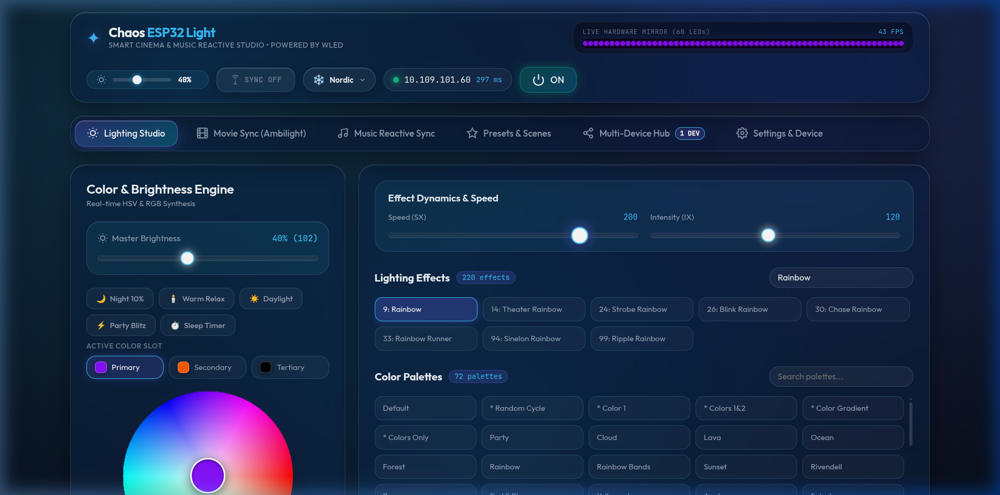
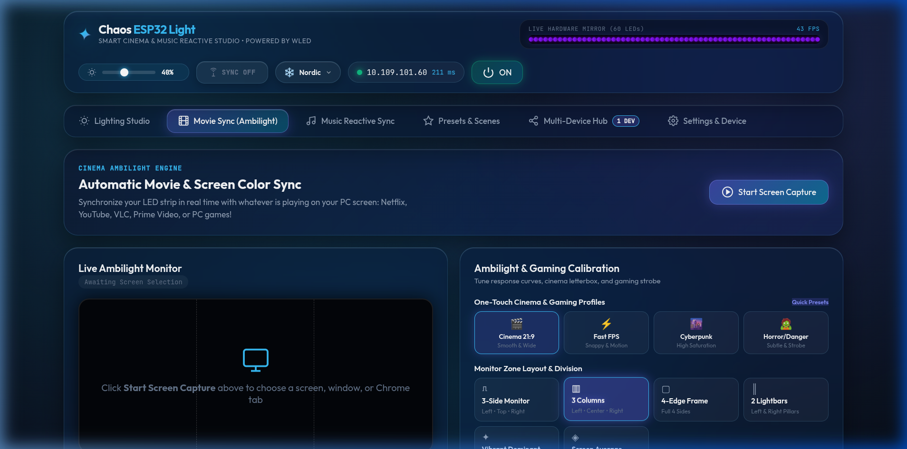
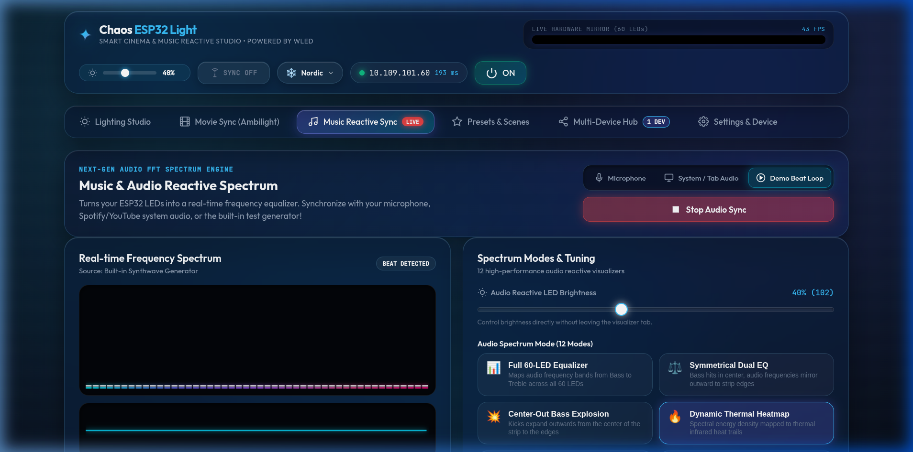
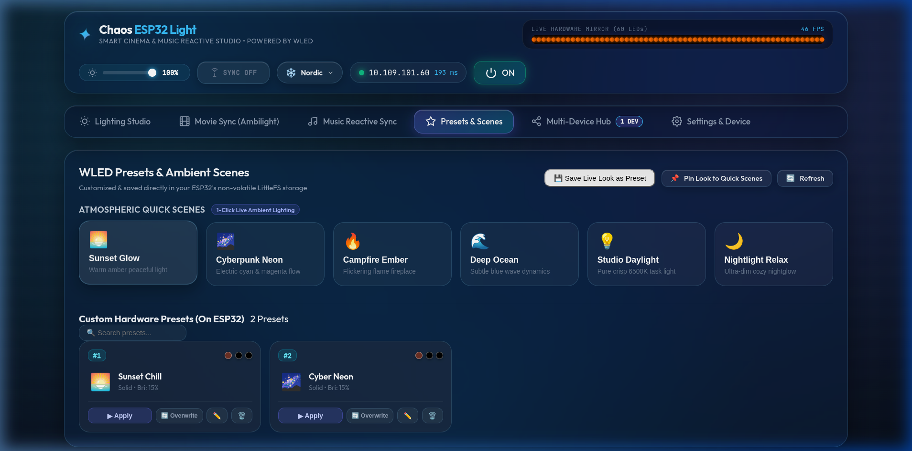
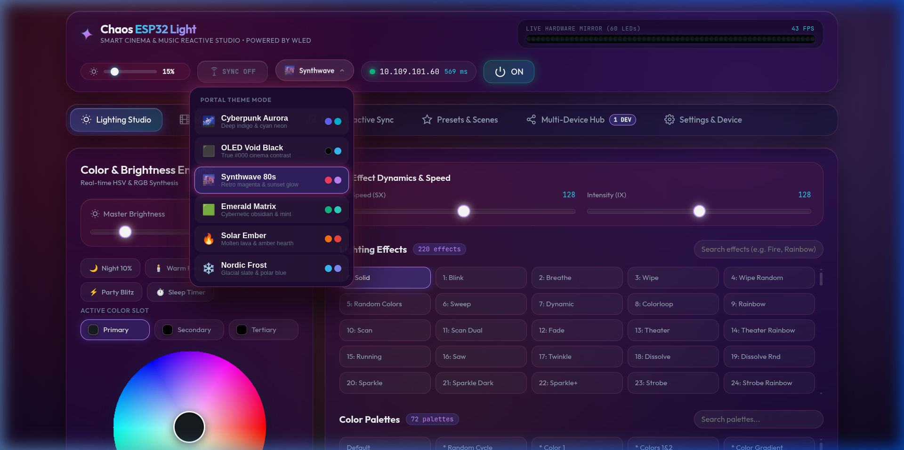
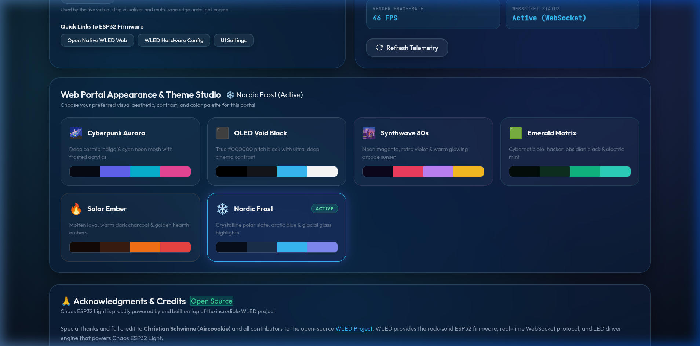
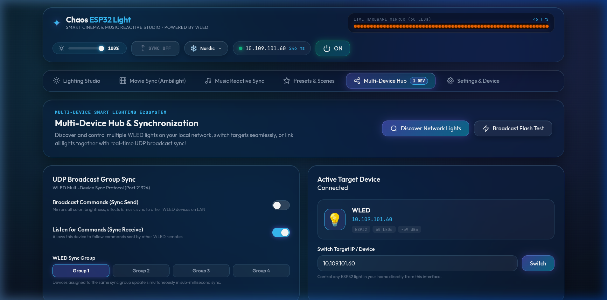

# ⚡ Chaos ESP32 Light — Smart Cinema Ambilight & Music Reactive Studio

<div align="center">


<p align="center">
  <strong>Transform your room into an intelligent cinema and music reactive stage.</strong><br>
  Sync your WS2812B / WS2811 / SK6812 LEDs in real time with movies, gameplay, and music with sub-15ms WebSocket responsiveness — running as a single, offline LittleFS web hub on your ESP32.
</p>

<p align="center">
  <a href="#-quickstart-in-60-seconds"><strong>⚡ Quick Start</strong></a> •
  <a href="#-the-visual-tour"><strong>📸 Feature Tour</strong></a> •
  <a href="MANUAL.md"><strong>📖 User Manual</strong></a> •
  <a href="HARDWARE.md"><strong>🔌 Hardware Guide</strong></a> •
  <a href="ARCHITECTURE.md"><strong>🏛️ Architecture</strong></a> •
  <a href="CHANGELOG.md"><strong>📝 Changelog</strong></a>
</p>

---

<p align="center">
  
</p>

</div>

---

## 🌟 Why You'll Love It

* 💡 **Lighting Studio & Dynamic FX**: Interactive HSV color wheel, 220 native WLED lighting effects, 72 color palettes, and quick mood presets.
* 🎬 **Cinema & Gaming Ambilight**: Turn any desktop monitor, ultrawide, or TV into an immersive screen-sync display.
* 🛡️ **Zero-Jitter Anti-Flicker Engine**: Deadband noise gate swallows video compression jitter and film grain on steady shots.
* ⚡ **Instant Scene-Cut Snap**: Accelerates transitions dynamically to 0 ms on explosions and cuts — zero trailing delay.
* 🎵 **Microphone-Free Audio Reactivity**: Uses your browser's Web Audio API for real-time 256-band FFT spectrum lighting — no extra microphone hardware or soldering required!
* 🎨 **6 Bespoke Portal Themes**: Switch between Synthwave 80s, OLED Void Black, Cyberpunk Aurora, Emerald Matrix, Solar Ember, and Nordic Frost.
* 💾 **LittleFS Hardware Presets**: Save looks directly to the ESP32's non-volatile flash memory with emoji avatars and quick scenes.
* 📦 **Zero-Config LittleFS Bundle**: One single compiled file (`index.htm`, ~244 KB) stored directly on the ESP32. 100% offline, zero cloud or CDN dependencies!

---

## 📸 The Visual Tour

### 1. 💡 Lighting Studio & Real-Time Color Engine
Real-time HSV color wheel synthesis, primary/secondary/tertiary color slots, 220 animated lighting effects, 72 color palettes, and instant speed/intensity tuning.

<p align="center">
  
</p>

* 🎨 **Interactive Color Wheel**: Drag to blend HSV hues smoothly with real-time hardware mirroring.
* ✨ **220 Hardware Effects & 72 Palettes**: Instant search filtering for effects like Rainbow, Fire, Twinkle, and Sinelon.
* ⚡ **Live Virtual LED Mirror**: 60-LED canvas strip simulation running at 40+ FPS with sub-millisecond telemetry.

---

### 2. 🎬 Cinema Ambilight & Gaming Studio
Stream movies from Netflix, YouTube, VLC, or PC games directly to your LED strip with custom zone splits and zero flicker.

<p align="center">
  
</p>

* 🛡️ **Smart Anti-Flicker Deadband**: A noise gate eliminates micro-fluctuations from video compression and film grain.
* ⚡ **Instant Scene-Cut Snapping**: Instantly snaps colors on scene cuts ($\Delta \ge 100$) so lighting is never "too late".
* 📐 **Custom Monitor Zones & Division**: Pre-tuned for 3-side monitors (`3-4-2`, `1-2-1`), 3 columns, 4-edge frames, or lightbars.
* 🍿 **Dynamic Letterbox Crop**: Automatically ignores 21:9 black cinematic bars so edge colors remain accurate.
* 🕹️ **One-Touch Calibration Profiles**: Instant 1-click profiles for Cinema 21:9, Fast FPS Esports, Cyberpunk Neon, and Low HP Alert.

---

### 3. 🎵 Music Reactive FFT Spectrum Studio
Turn any track from Spotify, YouTube, your PC audio, or microphone into a living frequency visualizer.

<p align="center">
  
</p>

* 🎙️ **Zero Extra Hardware**: No microphone modules (INMP441) or soldering needed — audio is analyzed directly via Web Audio API.
* 🎛️ **12 Dynamic Reactive Modes**: Full 60-LED Equalizer, Symmetrical Dual EQ, Bass Explosions, Heatmaps, and Chill Flow.
* 🌈 **14 Curated Color Themes**: Cyberpunk, Classic VU, Magma Fire, Synthwave Neon, Blood Moon, and more.
* 🥁 **Beat Transient Peak Detection**: Tracks kick and snare energy peaks with automatic noise floor thresholding.

---

### 4. 💾 Hardware Presets & Atmosphere Scenes
Control and personalize your room's mood in one tap, saved permanently to ESP32 LittleFS flash.

<p align="center">
  
</p>

* 🌅 **Quick Atmospheric Scenes**: Sunset Glow, Cyberpunk Neon, Campfire Ember, Deep Ocean, and Studio Daylight.
* 🏷️ **Emoji Tagging**: Give custom presets cute avatar tags (🌅, ⚡, 🌆, 🌌, 🔥, 💎, 🎮, 🌿) for rapid visual scanning.
* 📌 **Pin to Header**: Keep your favorite scenes right on the top navigation bar for 1-click room transitions.

---

### 5. 🎨 6-Mode Portal Theme Engine & Theme Studio
Tailor the web portal's visual aesthetic to match your ambient environment or room lighting setup.

<p align="center">
  
</p>

<p align="center">
  
</p>

* 🌌 **6 Bespoke Themes**: Cyberpunk Aurora, OLED Void Black (#000000 true cinema contrast), Synthwave 80s, Emerald Matrix, Solar Ember, and Nordic Frost.
* 🛸 **High-Contrast Floating Dropdown**: Frosted opaque acrylic backdrops with zero text bleed-through and instant theme switching.
* 🎚️ **Theme Studio Showcase**: Interactive palette swatches and theme preview cards in the Settings tab.

---

### 6. 🌐 Multi-Device Hub & LAN Synchronization
Discover and coordinate multiple ESP32 and WLED nodes across your local Wi-Fi network.

<p align="center">
  
</p>

* 📡 **UDP Broadcast Group Sync**: Synchronize color, brightness, effects, and music reactive visuals to all lights simultaneously on UDP port 21324.
* 🔍 **Network Node Discovery**: Scan subnet for online controllers and switch active target device in one click.
* 📶 **Live Telemetry & Diagnostics**: Real-time Wi-Fi RSSI signal strength, ping latency, and frame-rate monitors.

---

## ⚡ Quickstart in 60 Seconds

You don't need Node.js or any compilation tools installed! The pre-built bundle is ready to flash directly from `dist/index.htm`.

### Method 1: Instant Terminal Upload (Recommended)
Make sure your computer is connected to the same Wi-Fi as your ESP32, then run:

```bash
curl -F "data=@dist/index.htm;filename=/index.htm" http://<YOUR_ESP32_IP>/upload
```
*(Example: `curl -F "data=@dist/index.htm;filename=/index.htm" http://10.109.101.60/upload`)*

Open **`http://<YOUR_ESP32_IP>/`** in your browser and you're good to go! 🎉

---

### Method 2: Web Browser GUI Upload
1. Open `http://<YOUR_ESP32_IP>/edit` in Chrome or Edge.
2. Under **File Upload**, select `dist/index.htm`.
3. Set the target path to `/index.htm` and click **Upload**.
4. Refresh `http://<YOUR_ESP32_IP>/`.

---

## 🔍 Deep Dive & Technical Specs

<details>
<summary><strong>🔌 Hardware Bill of Materials (BOM) & Wiring Schematic</strong></summary>
<br>

### Recommended Hardware
* **Microcontroller**: ESP32 DevKit V1 (30-pin or 38-pin)
* **LED Strip**: WS2812B, WS2811, or SK6812 (60 LEDs/meter recommended)
* **Power Supply**: 5V DC (3A–10A depending on LED count)
* **Level Shifter**: 74AHCT125 or SN74HCT245 (converts ESP32 3.3V logic to 5V data)
* **Capacitor & Resistor**: 1000 µF electrolytic capacitor across 5V/GND, 330Ω–470Ω resistor on data line

### Circuit Schematic
```text
          +-------------------+
          |  5V 10A DC Power  |
          +---+-----------+---+
              |           |
              | +5V       | GND
              |           |
    +---------+-----------+-------------------------+
    |         |           |                         |
    |         |           | +5V                     | GND
    |         |        +--+--+                   +--+--+
    |         |        | VCC |                   | +5V |
    |      +--+--+     |     |  Level Shifter    |     |  WS2812B Strip
    |      | VIN |     |     |  (74AHCT125)      | DIN |◄--[ 330Ω Resistor ]
    |      |     |     |     +----[ 5V Data ]----+     |         ▲
    |      |ESP32|     | 1A  |                   | GND |         |
    |      |     |     +--+--+                   +--+--+         |
    |      |GPIO2+--------+ (3.3V Data)             |            |
    |      |     |                                  |            |
    |      | GND |                                  |            |
    |      +--+--+                                  |            |
    |         |                                     |            |
    +---------+-------------------------------------+------------+
                         COMMON GROUND
```
> [!IMPORTANT]
> **Common Ground**: Always connect the ground (`GND`) pin of the ESP32, power supply, and LED strip together to prevent erratic flickering.

</details>

<details>
<summary><strong>📐 3-Zone Monitor Setup & Custom Ratio Guide</strong></summary>
<br>

Desktop monitors sit on a desk or monitor stand, meaning lights usually run only along the **Left, Top, and Right** edges. Chaos ESP32 Light handles this natively:

| Ratio Preset | Left Edge | Top Edge | Right Edge | Ideal Monitor Type |
| :---: | :---: | :---: | :---: | :--- |
| **`3 : 4 : 2`** | 20 LEDs (33%) | 27 LEDs (45%) | 13 LEDs (22%) | **Custom Asymmetric** (taller left lightbar or custom wiring) |
| **`1 : 2 : 1`** | 15 LEDs (25%) | 30 LEDs (50%) | 15 LEDs (25%) | **Standard 16:9 Displays** (24", 27", 32") |
| **`1 : 1 : 1`** | 20 LEDs (33%) | 20 LEDs (33%) | 20 LEDs (33%) | **Equal Sides** / Square / Portrait Displays |
| **`1 : 3 : 1`** | 12 LEDs (20%) | 36 LEDs (60%) | 12 LEDs (20%) | **21:9 Ultrawide Monitors** (34", 38") |
| **`3 : 5 : 3`** | 16 LEDs (27%) | 28 LEDs (46%) | 16 LEDs (27%) | **32:9 Super Ultrawide** (49") |

Type any numbers (e.g. `3-4-2` or `20-27-13`) into the **Custom Division Ratio** input box to set exact LED counts on the fly.

</details>

<details>
<summary><strong>🧠 How the Adaptive Anti-Flicker & Scene-Cut Snap Works</strong></summary>
<br>

Video streams have film grain and codec artifacts that jitter $\pm 2$ to $5$ values every frame:
1. **Deadband Filter ($\Delta \le 6$)**: When the total color difference $\Delta = |\Delta R| + |\Delta G| + |\Delta B|$ is below the deadband threshold, the output freezes completely. Steady scenes stay completely still with zero twitching.
2. **Velocity-Aware Acceleration ($\Delta \ge 85$)**: On rapid camera cuts or explosions, $\alpha$ automatically accelerates to `0.95`, eliminating the slow transition lag of conventional lerp smoothers.
3. **ESP32 Network Pacing**: WebSocket packets are paced at ~33 FPS (28 ms throttle) with payload deduplication, preventing the ESP32's micro-controller TCP socket queue from overflowing.

</details>

<details>
<summary><strong>💻 Building From Source & Developer Instructions</strong></summary>
<br>

```bash
# Clone repository
git clone git@github.com:as-repo1/chaos-esp32-light.git
cd chaos-esp32-light

# Install dependencies
npm install

# Start local dev server with Hot Module Replacement
npm run dev

# Build standalone production bundle
npm run build && python3 inline_bundle.py
```

The output file `dist/index.htm` is bundled with all CSS, JavaScript, and assets inlined for LittleFS storage.

</details>

<details>
<summary><strong>❓ Frequently Asked Questions (FAQ)</strong></summary>
<br>

* **Q: Does screen capture work on Netflix or protected videos?**  
  *Yes!* Hardware acceleration in Chrome can occasionally blank protected DRM streams. If your screen captures as black, simply disable *"Use graphics acceleration when available"* in Chrome Settings (`chrome://settings/system`), or play the video in Firefox or VLC.
* **Q: Why do my LEDs flicker at 100% white brightness?**  
  High brightness draws up to 3.6A for 60 LEDs. Voltage drop along thin copper traces causes trailing LEDs to brown out or flicker. Ensure your 5V power supply provides sufficient amperage and inject power at both ends of the strip for runs over 60 LEDs.
* **Q: Do I have to manually restore WLED after syncing?**  
  *No!* Stopping Movie Sync or Music Sync automatically sends a cleanup packet that unfreezes segments (`frz: false`) and restores your normal WLED effects and brightness.

</details>

---

## 🙏 Acknowledgments & Credits

Chaos ESP32 Light is proudly built on top of the extraordinary **[WLED Project](https://github.com/Aircoookie/WLED)**.

* **Christian Schwinne ([@Aircoookie](https://github.com/Aircoookie))** and all WLED contributors for creating the world's most versatile, reliable open-source ESP8266/ESP32 LED firmware.
* The WLED WebSocket & JSON API, LittleFS architecture, and UDP real-time protocols that make browser-driven Ambilight and Audio FFT visualizers possible.
* **WLED Repository**: [github.com/Aircoookie/WLED](https://github.com/Aircoookie/WLED) • **Documentation**: [kno.wled.ge](https://kno.wled.ge/)

---

## 📄 License

This project is open-source under the [MIT License](LICENSE). Built with ❤️ for the lighting and maker community.
