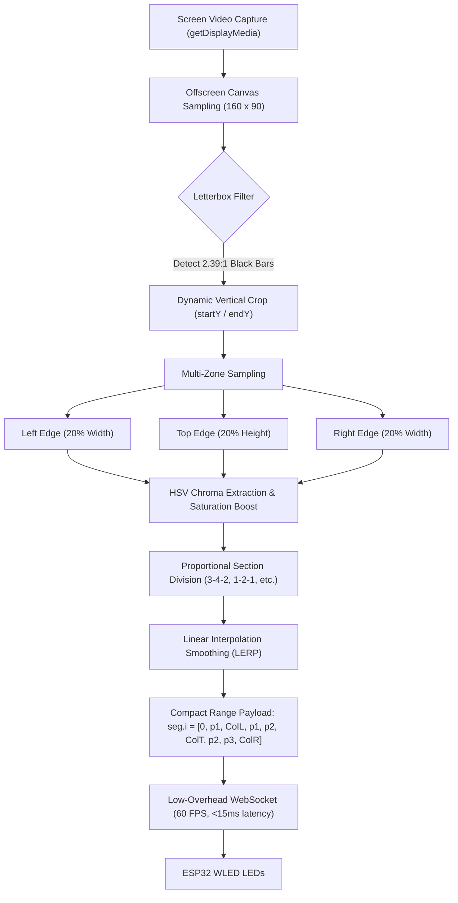
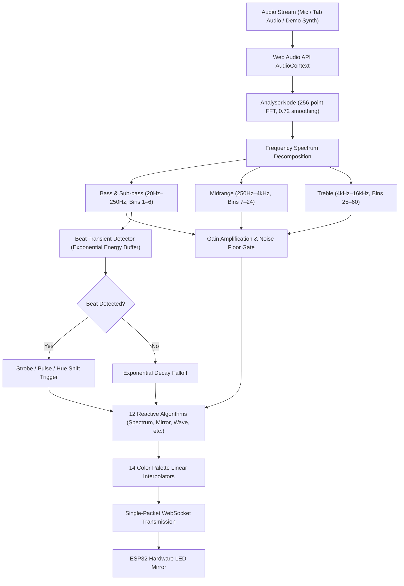

# ⚡ Chaos ESP32 Light — Smart Cinema Ambilight & Music Reactive Studio

<div align="center">


<p align="center">
  <strong>An ultra-fast, zero-dependency, glassmorphic web hub and real-time streaming engine for WLED / ESP32.</strong><br>
  Sync your WS2812B / WS2811 / SK6812 LEDs in real time with movies (Netflix, YouTube, VLC, PC games) and audio (Spotify, system audio, microphone) with sub-15ms latency over low-overhead WebSockets.
</p>

<p align="center">
  <a href="MANUAL.md"><strong>📖 User Manual</strong></a> •
  <a href="HARDWARE.md"><strong>🔌 Hardware Guide</strong></a> •
  <a href="ARCHITECTURE.md"><strong>🏛️ Architecture</strong></a> •
  <a href="API.md"><strong>📡 API Spec</strong></a> •
  <a href="CONTRIBUTING.md"><strong>🤝 Contributing</strong></a> •
  <a href="CHANGELOG.md"><strong>📝 Changelog</strong></a>
</p>

</div>

---

## 🌟 Highlights & Features

- 🖥️ **Cinema Ambilight Engine (60 FPS)**:
  - **3-Zone Monitor Mode**: Configured specifically for 3-sided desktop setups (Left, Top, Right) where desk stands obstruct the bottom edge.
  - **Section Division & Custom Ratios**: Customize LED distribution with presets like **`3-4-2 (Custom 3-Zone)`**, `1-2-1` (16:9 standard), `1-1-1` (equal), `1-3-1` (21:9 ultrawide), or enter any custom ratio or slider values.
  - **Dynamic Letterbox Crop**: Automatically detects and ignores black cinematic bars on 2.39:1 widescreen films.
  - **Dominant Chroma Extraction**: Uses 16-bucket HSV vibrancy analysis to isolate vivid foreground scene colors instead of muddy brown/grey averages.
  - **Multi-Zone Layouts**: 3-Side Monitor, 3 Panoramic Columns, 4-Edge Perimeter, 2 Lightbar Pillars, Vibrant Dominant, and Weighted Average.
  - **Strip Wiring Sequence Selector**: Bottom-Left ➔ Top ➔ Right (Clockwise), Bottom-Right ➔ Top ➔ Left (Counter-Clockwise), or Horizontal Sweep.
  - **Zero-Latency Range Streaming**: Color data is encoded in a single WLED range packet (`seg.i = [start1, stop1, col1, start2, stop2, col2]`), minimizing WebSocket overhead.

- 🎵 **Music Reactive FFT Equalizer**:
  - **Zero-Hardware Audio Reactivity**: Runs directly in the browser via Web Audio API; no external I2S microphones or INMP441 wiring needed on the ESP32!
  - **Dual Source Support**: Microphone / Headset, System Audio (YouTube, Spotify, PC output), or Built-in Synthwave Demo Loop.
  - **12 Dynamic Reactive Algorithms**: Full Spectrum Equalizer, Symmetrical Center Mirror, Thermal Heatmap, Frequency Shockwave, Kinetic Pulse, Twinkling Starfield, BPM Rhythm Comet, Center Pulse, VU Meter, Beat Strobe, Frequency Rainbow, and Chill Ambient Flow.
  - **14 Curated Color Themes**: Cyberpunk, Classic VU Meter, Fire & Magma, Ocean Ice, Synthwave Neon, Matrix Green, Aurora Borealis, Toxic Sunset, Blood Moon, Vaporwave Pastel, Deep Space, Solar Flare, Arctic Mint, and Custom Mix.
  - **Beat Transient Detection**: Real-time energy peak tracking with dynamic noise floor gates and customizable decay speeds.

- 🎨 **Multi-Theme Portal Engine**:
  - 6 bespoke visual modes: **Aurora** (midnight cyan/magenta), **OLED Void Black** (pure pitch black), **Synthwave 80s** (retro neon purple/pink), **Emerald Matrix** (cybernetic terminal green), **Solar Ember** (magma red/orange), and **Nordic Frost** (arctic glacier blue).
  - Quick-switch dropdown in the top header and dedicated Theme Studio in Settings.

- 💾 **Hardware Preset Studio & Quick Scenes**:
  - Create, overwrite, rename, and delete presets saved permanently to ESP32 LittleFS `/presets.json`.
  - Emoji avatar tags (🌅, ⚡, 🌆, 🌌, 🔥, 💎, 🎮, 🌿) for rapid visual scanning.
  - Pin favorite presets directly to the **Quick Scenes** bar for 1-click room mood transitions.

- 🌐 **Multi-Device Network Hub & UDP Sync**:
  - Automatically scans and controls multiple WLED nodes across your local subnet.
  - Broadcast group synchronization over UDP port 21324 with 1-click sync testing.

- 📦 **Plug & Play Standalone LittleFS Bundle**:
  - A single self-contained `index.htm` bundle (~219 KB) containing all HTML, CSS, JavaScript, and SVG icons.
  - **Zero cloud or CDN dependencies**: Works completely offline on isolated Wi-Fi subnets.

---

## 🚀 Quickstart: Plug & Play in 60 Seconds

You don't need Node.js or any compilation tools installed to use Chaos ESP32 Light! The production-ready standalone bundle is already compiled in `dist/index.htm`.

### Method 1: Instant 1-Line Terminal Upload (Recommended)

Connect your computer to the same Wi-Fi network as your ESP32, then run:

```bash
curl -F "data=@dist/index.htm;filename=/index.htm" http://<YOUR_ESP32_IP>/upload
```
*(Example: `curl -F "data=@dist/index.htm;filename=/index.htm" http://10.109.101.60/upload`)*

That's it! Open `http://<YOUR_ESP32_IP>/` in your browser.

---

### Method 2: Web Browser GUI Upload

1. Navigate to `http://<YOUR_ESP32_IP>/edit` in Google Chrome or Microsoft Edge.
2. Under **File Upload**, select `dist/index.htm`.
3. Set the target path to `/index.htm` and click **Upload**.
4. Refresh `http://<YOUR_ESP32_IP>/`.

---

## 🔌 Hardware Bill of Materials & Wiring Schematics

### Bill of Materials (BOM)

| Component | Recommended Model | Purpose |
| :--- | :--- | :--- |
| **Microcontroller** | ESP32 DevKit V1 (30-pin or 38-pin) | WLED controller running WebSocket & UDP server |
| **Addressable LEDs** | WS2812B / WS2811 / SK6812 (60 LEDs/m) | RGB / RGBW perimeter lighting strip |
| **Power Supply** | 5V 5A–10A DC Power Supply | Supplies stable current to ESP32 and LEDs |
| **Logic Level Shifter** | 74AHCT125 or SN74HCT245 | Boosts ESP32 3.3V GPIO data signal to 5V CMOS level |
| **Filter Capacitor** | 1000 µF 6.3V–16V Electrolytic | Prevents voltage sag and inrush current spikes |
| **Data Resistor** | 330Ω to 470Ω 1/4W | Suppresses signal reflections on data line |

---

### Circuit Wiring Schematic

```
          +-------------------+
          |  5V 10A DC Power  |
          +---+-----------+---+
              |           |
              | +5V       | GND
              |           |
    +---------+-----------+-------------------------+
    |         |           |                         |
    |         |           | +5V                     | GND
    |         |        +--+--+                   +--+--+
    |         |        | VCC |                   | +5V |
    |      +--+--+     |     |  Level Shifter    |     |  WS2812B Strip
    |      | VIN |     |     |  (74AHCT125)      | DIN |◄--[ 330Ω Resistor ]
    |      |     |     |     +----[ 5V Data ]----+     |         ▲
    |      |ESP32|     | 1A  |                   | GND |         |
    |      |     |     +--+--+                   +--+--+         |
    |      |GPIO2+--------+ (3.3V Data)             |            |
    |      |     |                                  |            |
    |      | GND |                                  |            |
    |      +--+--+                                  |            |
    |         |                                     |            |
    +---------+-------------------------------------+------------+
                         COMMON GROUND
```

> [!IMPORTANT]
> **Common Ground**: Always tie the ground (`GND`) pin of the ESP32, power supply, and LED strip together to prevent signal noise and erratic flashing.
> **Power Budget**: Each WS2812B LED draws up to 60mA at full white brightness. For 60 LEDs, plan for $60 \times 0.06\text{A} = 3.6\text{A}$ ($18\text{W}$).

---

## 🏗️ Architecture & Base Pipelines: How It Works

### 1. Screen Ambilight Cinema Pipeline



#### Pipeline Technical Details:
1. **Screen Frame Downsampling**: The browser captures the display surface at 60 FPS and draws it to a `160x90` offscreen 2D canvas with `{ willReadFrequently: true }`.
2. **Dynamic Letterbox Crop**: Analyzes top and bottom horizontal scanlines. If black bars are detected (brightness $< 25$), the sampling bounding box shifts inward automatically so widescreen 2.39:1 films don't cause black ambilight bars.
3. **HSV Vibrant Chroma Filter**: Extracts colors into 12 hue buckets weighted by $S^2 \times V^{1.2}$. Muddy desktop backgrounds and neutral greys are discarded in favor of rich, vibrant scene colors.
4. **Proportional Section Division**: Maps edge colors across your strip according to user ratios (e.g. `3 : 4 : 2` ➔ 20 Left, 27 Top, 13 Right).
5. **LERP Response Smoothing**: Smooths transitions using $C_{t} = C_{t-1} + (C_{\text{target}} - C_{t-1}) \times \alpha$ ($\alpha = 0.35$ responsive).
6. **WLED Range API**: Emits WLED range arrays `[start, stop, [r, g, b]]` with `transition: 0` and `frz: true` to bypass internal WLED crossfades and deliver instantaneous frame response.

---

### 2. Audio Reactive Spectrum Pipeline



---

## 🖥️ Calibration Manual: 3-Zone Monitor Setup

### Why 3-Side Monitor?
Desktop monitors sit on a desk or monitor arm, meaning LED strips cannot wrap across the bottom edge. Standard ambilight kits fail here because they assume a 4-sided TV frame. Chaos ESP32 Light natively solves this with dedicated **3-Side Monitor** geometry.

### Configuring Section Divisions:
Navigate to **Movie Sync (Ambilight) ➔ Section Division & LED Distribution**:

| Ratio Preset | Left Edge | Top Edge | Right Edge | Best Suited For |
| :---: | :---: | :---: | :---: | :--- |
| **`3 : 4 : 2`** | 20 LEDs (33%) | 27 LEDs (45%) | 13 LEDs (22%) | **Custom User Division** (taller left pillar / asymmetric wiring) |
| **`1 : 2 : 1`** | 15 LEDs (25%) | 30 LEDs (50%) | 15 LEDs (25%) | **Standard 16:9 Monitor** (27", 32") |
| **`1 : 1 : 1`** | 20 LEDs (33%) | 20 LEDs (33%) | 20 LEDs (33%) | **Equal Thirds** / Square / Portrait monitors |
| **`1 : 3 : 1`** | 12 LEDs (20%) | 36 LEDs (60%) | 12 LEDs (20%) | **21:9 Ultrawide Monitors** (34", 38") |
| **`2 : 3 : 2`** | 17 LEDs (28%) | 26 LEDs (44%) | 17 LEDs (28%) | **16:10 Aspect Ratio** Displays |
| **`3 : 5 : 3`** | 16 LEDs (27%) | 28 LEDs (46%) | 16 LEDs (27%) | **32:9 Super Ultrawide** (49") |

### Custom Ratios:
Type any custom distribution (such as `3-4-2`, `3:4:2`, or exact counts `20-27-13`) into the **Custom Division Ratio** input and click **Apply**. The sliders and live hardware mirror will adjust immediately.

### Wiring Sequence Options:
- **Bottom-Left ➔ Top ➔ Right (Clockwise)**: Standard sequence where strip begins at bottom-left corner, runs up left side, across top, and down right side.
- **Bottom-Right ➔ Top ➔ Left (Counter-Clockwise)**: For strips starting on bottom-right corner.
- **Left ➔ Top ➔ Right (Sweep)**: Direct linear progression.

---

## 💻 Local Development & Building

To run the development server or compile custom modifications:

```bash
# 1. Clone the repository
git clone git@github.com:as-repo1/chaos-esp32-light.git
cd chaos-esp32-light

# 2. Install dependencies
npm install

# 3. Start local development server with Hot Module Replacement
npm run dev

# 4. Build and inline the single-file production bundle
npm run build && python3 inline_bundle.py
```

The resulting `dist/index.htm` is fully self-contained and ready to flash to any ESP32 running WLED.

---

## 🛠️ Wi-Fi & Network Configuration

- **Default Pre-configured SSID**: `pk`
- **Default Wi-Fi Password**: `00000000`
- **Target Device IP**: `10.109.101.60` (or your ESP32's assigned DHCP IP)
- Wi-Fi credentials can be changed live from the **Settings & Device** tab, which saves them directly to WLED's non-volatile EEPROM storage.

---

## ❓ Frequently Asked Questions (FAQ)

<details>
<summary><strong>Q: Does screen capture work on Netflix / protected DRM content?</strong></summary>
<p>
Yes! However, hardware-accelerated video decoding in Google Chrome (Widevine DRM) may output black frames for DRM-protected streams. To bypass this for Ambilight syncing, disable <em>"Use graphics acceleration when available"</em> in Chrome Settings (<code>chrome://settings/system</code>), or play video via VLC / MPV / Firefox.
</p>
</details>

<details>
<summary><strong>Q: Why does my LED strip flicker when brightness is turned to 100%?</strong></summary>
<p>
Flickering at high brightness is caused by voltage drop across the copper traces of the LED strip. For 60+ LEDs, inject 5V power at both ends of the strip, and verify your 5V power supply can provide at least 4 Amps.
</p>
</details>

<details>
<summary><strong>Q: Do I need to unfreeze segments after stopping sync?</strong></summary>
<p>
Chaos ESP32 Light handles this automatically! When you click <em>Stop Screen Sync</em> or <em>Stop Audio Sync</em>, the engine sends a restore packet with <code>frz: false</code> and restores your normal WLED presets, colors, and effects.
</p>
</details>

---

## 🙏 Acknowledgments & Credits

Chaos ESP32 Light is proudly built on top of and powered by the extraordinary **[WLED Project](https://github.com/Aircoookie/WLED)**.

- **Christian Schwinne ([@Aircoookie](https://github.com/Aircoookie))** and all WLED community contributors for creating the world's most versatile, reliable open-source ESP8266/ESP32 addressable LED controller firmware.
- The WLED WebSocket & JSON API, LittleFS architecture, and UDP real-time synchronization protocols that make high-speed browser-based Ambilight and Audio FFT visualizers possible.
- **Official WLED Project Repository**: [github.com/Aircoookie/WLED](https://github.com/Aircoookie/WLED)
- **Official WLED Documentation & Knowledge Base**: [kno.wled.ge](https://kno.wled.ge/)

---

## 📄 License

This project is licensed under the [MIT License](LICENSE). Built with ❤️ for the open-source lighting and maker community.
